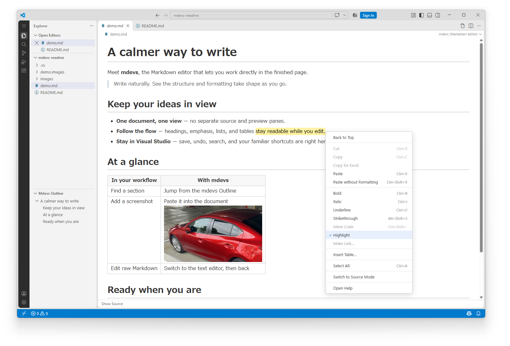
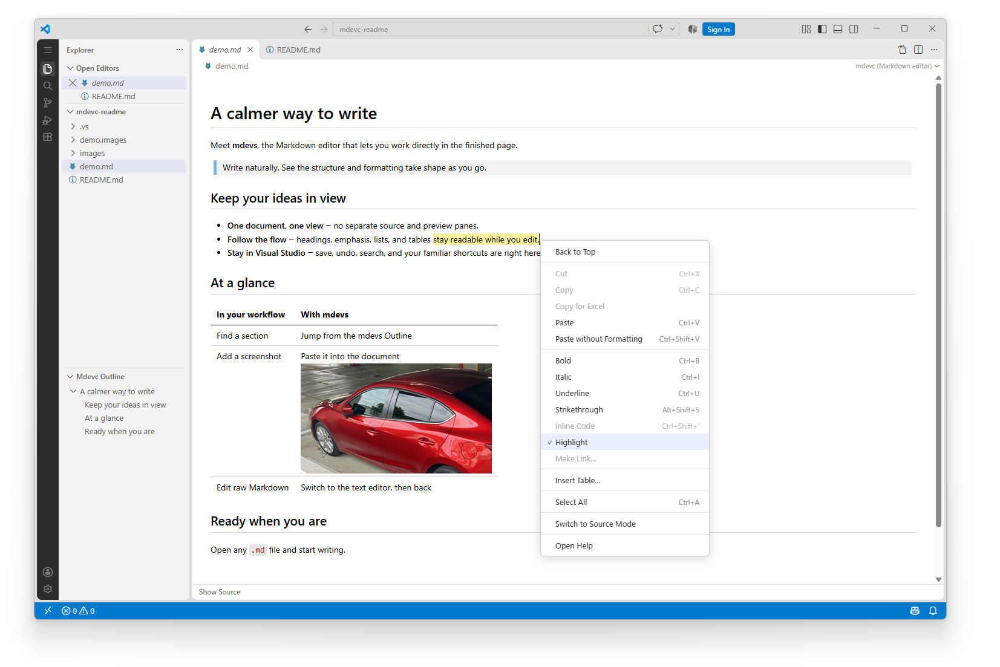
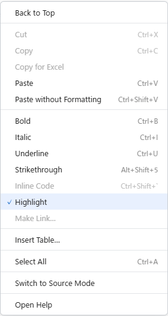
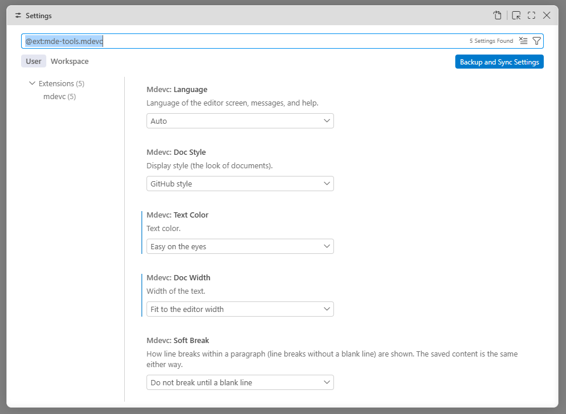

# mdevc — Edit Markdown right in the preview

**Write Markdown in VS Code the way you read it.** mdevc turns `.md` files into a page you edit directly:
headings, lists, tables, and images take shape as you type. No source pane, no preview pane, no switching back and
forth — and the file you save is still plain Markdown.

日本語の説明は [README.ja.md](README.ja.md) を参照してください。



## Why mdevc

- **One view, what you see is what you save** — Type `## `, `**bold**`, `- `, or `|a|b|` and the formatting appears
  as soon as you finish the mark.
- **Clean diffs** — Only the blocks you actually edit are rewritten. Everything else keeps its original spacing and
  line breaks, so opening and saving a file does not fill your Git diff with noise.
- **Tables that are easy to work with** — Tab between cells, add rows with `Ctrl+Enter`, and insert or delete rows and
  columns from the right-click menu.
- **Paste screenshots** — `Ctrl+V` saves the image next to your file and inserts a relative link for you.
- **Works with Excel and Word** — Paste an Excel range to get a Markdown table. "Copy for Excel" sends headings,
  lists, and tables back to Excel one cell per line; normal copy pastes into Word with formatting.
- **Still VS Code** — Save, undo, dirty markers, Find in Files, and your shortcuts behave as usual. An Outline view
  lets you jump through long documents.
- **Two looks, light or dark** — GitHub style or VS Code preview style, following your color theme.
  English and Japanese UI.

## Choose your style

Prefer the look of the built-in VS Code Markdown preview? Switch **Doc Style** in Settings. The editing features are the
same in both styles.



## Get started

1. Install **mdevc** from the Extensions view (`Ctrl+Shift+X`) by searching for "mdevc".
2. Open any `.md` or `.markdown` file. It opens in mdevc.
3. Write, then save with `Ctrl+S`.

Requires VS Code 1.90 or later.

To edit a file as plain text, click **Reopen with Text Editor** at the top right of the editor
(or run "mdevc: Reopen with Text Editor" from the Command Palette). Click **Reopen with mdevc** to come back.

> **Full help is built in.** Right-click in the editor → **Open Help** (or "mdevc: Open Help" in the Command Palette)
> opens a complete, read-only guide in the language of the editor.

## Everything at your right click



Right-click in the document for the commands you use most:

- Back to Top
- Cut, Copy, **Copy for Excel**, Paste, **Paste without Formatting**
- Bold, Italic, Underline, Strikethrough, Inline Code, Highlight
- **Make Link…** and **Insert Table…**
- On a link: **Open Link**, **Copy URL**, **Edit Link…**, and **Remove Link**
- On an image: **Open Image** and **Image Size**
- **Switch to Source Mode** and **Open Help**

Commands that already apply to the selection are checked (✓). Right-click a table cell for table commands, and a
paragraph or heading to change the heading level.

<br clear="right">

## Writing at a glance

| To get | Type (or use) |
|---|---|
| Heading | `# ` to `###### ` at the start of a line |
| Quote | `> ` at the start of a line |
| Bold / Italic | `**text**` / `*text*`, or `Ctrl+B` / `Ctrl+I` |
| Underline | Select text and press `Ctrl+U` |
| Strikethrough / Highlight | `~~text~~` (`Alt+Shift+5`) / `==text==` |
| Inline code | `` `text` `` |
| Bulleted / numbered list | `- ` / `1. ` at the start of a line |
| Check box | `[ ] ` or `[x] ` at the start of a list item |
| Code block | ```` ``` ```` (optionally with a language) and Enter |
| Horizontal rule | `---` and Enter |
| Table | `\|Header 1\|Header 2\|` and Enter, or **Insert Table…** |
| Link | `[text](URL)`, or select text → **Make Link…** |

**Lists:** Enter adds an item, Tab / Shift+Tab indents / outdents, Shift+Enter breaks the line inside an item,
and Enter on an empty item leaves the list.
**Tables:** Tab / Shift+Tab move between cells (Tab in the last cell adds a row), Enter moves to the cell below,
Shift+Enter breaks the line inside a cell, Ctrl+Enter inserts a row below.

## Find, navigate, and view the source

- **Find and replace** — `Ctrl+F` / `Ctrl+H` open a find bar at the top right, just like the VS Code text editor.

  | Operation | Keys |
  |---|---|
  | Find next / previous | Enter / Shift+Enter (F3 / Shift+F3) |
  | Replace and find next | Enter in the replace box |
  | Replace all | Ctrl+Alt+Enter |
  | Match case / whole word / regex | Alt+C / Alt+W / Alt+R |
  | Close | Esc |

- **Find in Files** — `Ctrl+Shift+F` / `Ctrl+Shift+H` work as usual, and replacements show up immediately in open
  mdevc editors.
- **mdevc Outline** — The Explorer side bar lists the headings of the current document. Click one to jump to it;
  headings that contain search matches are emphasized. (The standard Outline cannot show a custom editor's headings,
  so mdevc provides its own.)
- **Source mode** — **Show Source** in the status bar at the bottom of the editor (or right-click →
  **Switch to Source Mode**) shows the raw Markdown; **Show Markdown** switches back.
- **Zoom** — `Ctrl++`, `Ctrl+-`, `Ctrl+0`, or Ctrl+mouse wheel.

## Images and links

Paste an image from the clipboard with `Ctrl+V`. It is saved right away in a `<file name>.images` folder next to the
file (for example `clipboard_image_1.png`), and a relative link is inserted. The file must have been saved at least once.
Right-click an image → **Image Size** to resize it (25% to 200% of the original). The size is saved as a `width`
attribute, so it looks the same on GitHub and in Typora.

Links open with a single click: web links in your browser, `#heading` links inside the document, and relative links to
other Markdown files in a new VS Code tab.

## Keyboard

Keys for editing (typing, Ctrl+B / Ctrl+I / Ctrl+U, Alt+Shift+5, undo / redo, copy / paste, zoom, etc.) are handled by
the editor. Other keys (Ctrl+S, Ctrl+P, Ctrl+Tab, Ctrl+W, F5, Ctrl+Shift+P, etc.) work as VS Code shortcuts.

## Settings



Open Settings (`Ctrl+,`) and search for "mdevc". Changes apply immediately to all open editors.

| Setting | Values |
|---|---|
| Language | Auto (default; follows the VS Code display language: Japanese if it is Japanese, otherwise English) / 日本語 (Japanese) / English |
| Doc Style | GitHub style (default) / VS Code style |
| Text Color | Sharp (default) / Easy on the eyes |
| Doc Width | Readable width (max 884px, default) / Fit to the editor width |
| Soft Break | Do not break until a blank line (default) / Break lines as in the source. Display only; the saved file is the same. |

The Language setting applies to the editor screen, the messages of the extension, and the help. Command and setting
names shown by VS Code itself follow the VS Code display language. Light and dark appearance follows your VS Code
color theme.

## Known limitations

- When you open a file from the Find in Files results, the editor shows the start of the file rather than the match.
  Use `Ctrl+F` to jump to it.
- Images written with an absolute path such as `C:\dir\a.png` are not shown (relative paths are).
- With "Copy for Excel", images in a table may not paste into Excel.

## Install from a VSIX file

1. Get the `mdevc-<version>.vsix` file.
2. In the Extensions view (`Ctrl+Shift+X`), open the "…" menu at the top right, choose "Install from VSIX...", and
   select the file. You can also run `code --install-extension mdevc-<version>.vsix`.

## Development

### Folder structure

| Path | Contents |
|---|---|
| `extension.js` | Entry point of the extension (registers the custom editor and commands) |
| `src/markdownEditor.js` | Syncing between the editor screen (webview) and the VS Code document, pasting images, opening links, etc. |
| `src/images.js` | Saving pasted images, resolving image and link targets |
| `src/outlineView.js` | "mdevc Outline" in the Explorer (the standard VS Code Outline cannot be used from a custom editor) |
| `src/i18n.js` | English text of the messages shown by the extension (the Japanese text is the key) |
| `src/log.js` | Log (the "mdevc" channel in the Output panel) |
| `package.nls.json` / `package.nls.ja.json` | Display strings in `package.json` (settings, commands, etc.) in English / Japanese |
| `README.md` / `README.ja.md` | This file (English) / Japanese version |
| `images/readme/` | Screenshots used in the README (not included in the VSIX; the Marketplace loads them from GitHub) |
| `CHANGELOG.md` | Change log (shown on the "Changelog" tab of the extension's details page) |
| `doc/` | Development notes (not included in the VSIX) |
| `help/HELP.en.md` / `help/HELP.md` | Help in English / Japanese (opened read-only from the right-click menu → Open Help. The one for the language of the editor is opened) |
| `web/` | Editor screen (HTML, JavaScript, CSS). `js/host.js` (communication with VS Code, key routing, colors), `js/findbar.js` (find and replace bar), `js/i18n.js` (English text of the editor screen; the Japanese text is the key) |

There is no build step (the extension runs as plain JavaScript).

### Trying it out

1. Open this folder in VS Code.
2. Press F5 to start a VS Code instance with mdevc loaded (Extension Development Host), and open a `.md` file.
3. The log is shown in the Output panel (Ctrl+Shift+U) by choosing "mdevc". For the editor screen itself, press F12 in
   the editor to open the developer tools.

### Building the VSIX

On a PC with Node.js installed, run the following command in this folder (the first time, you are asked to confirm
downloading vsce).

```
npm run package
```

(If running scripts is disabled in PowerShell, use `npm.cmd run package`. It runs `vsce package` from `scripts` in
`package.json`.)

This creates `mdevc-<version>.vsix`. Change the version with `version` in `package.json`, and record the changes in
`CHANGELOG.md` (shown on the "Changelog" tab of the extension's details page). The files to include in the VSIX are
listed in `.vscodeignore`, so notes in the `doc` folder and similar files are not included.

`vsce` rewrites the relative image paths in this README to URLs on GitHub (from `repository` in `package.json`), so
push the screenshots in `images/readme/` to GitHub before publishing.

## License

MIT License ([LICENSE.txt](LICENSE.txt))
